# Dashboard telemetry: handoff and design decisions

As of Oct 28, 2026 · prepared for the UIW-PMD team and the next coding agent

## Purpose

The team needs to make six design decisions before more telemetry is added to the dashboard. A coding agent then builds whatever the team chooses. Nothing in this document has been built yet.

- **Team:** work through the decision tree in order, then fill in the [decision record](#decision-record) (choice, owner, date). Discuss in the pull request or in an issue.
- **Next agent:** build only the backlog items whose decision is marked **Decided**, using the team's recorded choice. Follow the [agent instructions](#agent-instructions) and don't make the open calls yourself.

The dashboard is the single file `git_project-dashboard.html`. The test project is [L1PsterGram/S25_CSS_05_DC_CR](https://github.com/L1PsterGram/S25_CSS_05_DC_CR).

## Current state

The Oct 28, 2026 dashboard change, included in the same pull request as this document, fixed item types and story points. It is already built; the team only decides on the further changes below.

| Area | How it works now |
| --- | --- |
| Item type | User Story, Issue, Task or Sub-task. Read from the GitHub issue type, then the title prefix ("User Story -", "Task:"), then labels. Shown as a tag on each row. |
| Grouping | Inside each milestone, items are grouped by type. An `objective::` label or a GitLab epic takes priority. |
| Nesting | A sub-item sits under its parent. Links come from GitHub sub-issues, "Parent: #7" or "Part of #7" in the body, or a `- [ ] #12` checklist in the parent. |
| Story points | Read from a GitHub Project field (Estimate, Story Points), GitLab weight, a `sp: 5` label, or "Story points: 5" in the body. No estimate shows "–"; nothing defaults to 1 any more. |
| Counting rule | An estimated item counts for its whole tree, so a story's tasks are not added again. An unestimated parent shows its sub-items' total. One function (`spSum`) feeds every view. |
| Sprint rule | "In a sprint" means "due inside it" (`dueIn`) in every view, including the Board. |

## Evidence from the test repo

The test repo has 51 issues, all created between Jan 23 and May 5, 2025, and nothing has been updated since May 10, 2025 (checked Oct 28, 2026).

| Gap | What the repo shows | What the dashboard does |
| --- | --- | --- |
| No progress without points | Only #4 has an estimate (Estimate = 6 on the Project). Every story body says "Estimation of effort: TBD". | Every SP cell shows "–"; burndown and velocity are empty. Milestone rows show a total ("10") but no done count. |
| Status hidden | The Project board has #8, #11, #16 "In review" and #14 "Ready". #12 is closed but still "In review" on the board. | Rows show only open or closed. Board status is read only when a token is connected. |
| No staleness signal | 34 open issues untouched for about 17 months. | A dead project looks the same as an active one. |
| Timeline squashed | Issues are more than a year old. | The loader looks back only 365 days, so every bar starts Oct 27, 2025, and commits are not fetched. |
| No real dates | Milestones 1–5 have no due date. The Project has an Iteration field (e.g. "Iteration 3"). | Milestones show TBD; Iteration is ignored and a 2-week calendar is invented. |
| Co-assignees dropped | 8 issues have two assignees (#3, 4, 7, 8, 9, 11, 16, 17). | Only the first counts, so co-assignees disappear. Unassigned items are shown as "Team". |
| Backlog hygiene | Acceptance criteria are "TBD" on every story; no tasks are linked to a story; 21 open issues have no assignee. | Not reported anywhere. |
| No proof of work | 2 PRs in the repo; no commits reference issue numbers. | No link between issues and code. |
| Comments missing | A few issues have comments. | The live loader never fetches comments, so Analytics always shows 0. Only demo data has them. |
| Edits stay local | — | Status drags, points and dates live only in this browser. Reload from GitHub erases them, and teammates never see them. |

## Critical design decision tree

Take the decisions top to bottom. D1 comes first because it decides whether anything edited in the dashboard reaches GitHub, which changes how D4 conflicts and estimates are handled. Whichever option is chosen, go on to the next decision. The highlighted option in each row is the recommendation; the second line in each box is its consequence, using this repo's numbers.

```mermaid
flowchart TD
  classDef rec fill:#dbeafe,stroke:#2563eb,stroke-width:2px,color:#0b1b33
  classDef opt fill:#ffffff,stroke:#9ca3af,color:#111827

  subgraph D1["D1 · Source of truth for live projects"]
    direction LR
    D1a["<b>Read-only mirror</b><br/>Reload is always safe<br/>Edits off for live projects"]:::rec
    D1b["<b>Two-way sync</b><br/>Edits write back to GitHub<br/>Needs write token, conflicts"]:::opt
    D1c["<b>Local planning layer</b><br/>Today's behaviour<br/>Reload erases team edits"]:::opt
  end
  subgraph D2["D2 · Unit of progress"]
    direction LR
    D2a["<b>Points + count fallback</b><br/>Counts when few are estimated<br/>Shows progress for this repo"]:::rec
    D2b["<b>Story points only</b><br/>Empty until the team estimates<br/>1 of 51 issues estimated now"]:::opt
    D2c["<b>Issue counts only</b><br/>Always available<br/>Ignores the size of work"]:::opt
  end
  subgraph D3["D3 · Where dates and sprints come from"]
    direction LR
    D3a["<b>Project Iteration + dates</b><br/>Real sprints from the board<br/>Needs read:project token"]:::rec
    D3b["<b>Milestone due dates</b><br/>No extra token needed<br/>All 5 milestones lack dates"]:::opt
    D3c["<b>Created and closed dates</b><br/>Today's behaviour<br/>Invents a 2-week calendar"]:::opt
  end
  subgraph D4["D4 · Status when repo and board disagree"]
    direction LR
    D4a["<b>Closed wins, flag mismatch</b><br/>Drift stays visible<br/>Issue 12 would be flagged"]:::rec
    D4b["<b>Board status wins</b><br/>Matches the team's board<br/>Can show closed work as open"]:::opt
    D4c["<b>Ignore board status</b><br/>No token needed<br/>Hides In review and Ready"]:::opt
  end
  subgraph D5["D5 · Credit for shared assignments"]
    direction LR
    D5a["<b>All assignees, split points</b><br/>Everyone shown on rows<br/>Member totals add up"]:::rec
    D5b["<b>First assignee only</b><br/>Today's behaviour<br/>Hides co-assignees on 8 items"]:::opt
    D5c["<b>Full points to each</b><br/>Simple per-person view<br/>Members exceed project total"]:::opt
  end
  subgraph D6["D6 · API budget for extra telemetry"]
    direction LR
    D6a["<b>Tier 1 now, Tier 2 later</b><br/>Tier 2 only with a token<br/>Stays under rate limits"]:::rec
    D6b["<b>Tier 1 only</b><br/>No extra API calls<br/>No PR or comment telemetry"]:::opt
    D6c["<b>Everything, always</b><br/>Full telemetry<br/>60 calls/hour without token"]:::opt
  end

  D1 --> D2 --> D3 --> D4 --> D5 --> D6
```

## Decision record

All six decisions are open. To decide one, edit this file in a pull request: set **Status** to Decided and fill in Choice, Owner and Date. The agent builds only Decided rows. The recommendations come from the evidence above.

| # | Decision | Recommended | Why | Status | Choice | Owner | Date |
| --- | --- | --- | --- | --- | --- | --- | --- |
| D1 | Source of truth for live projects | Read-only mirror, clearly labelled | Two-way sync needs write tokens and conflict handling; local-only edits are erased by Reload. | Open | | | |
| D2 | Unit of progress | Story points, with automatic fallback to issue counts | The test repo has 1 estimate in 51 issues, so points-only shows nothing. | Open | | | |
| D3 | Where dates and sprints come from | GitHub Project Iteration and date fields, then milestone due dates; timeline window follows the data | Today's 365-day window squashes older projects and invents sprints. | Open | | | |
| D4 | Status when repo and board disagree | Closed state wins; flag the mismatch | Closed is unambiguous; the board drifts (#12). | Open | | | |
| D5 | Credit for shared assignments | Every assignee gets the item; points split evenly | Keeps member totals equal to the project total while showing everyone. | Open | | | |
| D6 | API budget for telemetry | Tier 1 now (no extra calls); Tier 2 only with a token, capped | Per-issue calls hit the 60 requests/hour limit without a token. | Open | | | |

**D7, Definition of Ready:** the team should also agree which fields a story needs before it counts as ready (acceptance criteria, estimate, assignee, parent, milestone). This only shapes the backlog health panel, so it isn't in the table above.

## Build backlog

Eleven items. Ten wait on a decision; staleness can be built now. Tier 1 uses data the loader already fetches; Tier 2 needs extra API calls.

| Item | Depends on | Tier | Data source | Notes |
| --- | --- | --- | --- | --- |
| Progress column (done/total, %) on every row; count-based burndown | D2 | 1 | Issue state | Milestone rows currently show only a total. |
| Status pill per row; repo/board mismatch flag | D4 | 1 | Labels, Project Status field | Board status needs a token with `read:project`. |
| Staleness: days since update, time open, "stale" filter | none | 1 | `updated_at`, `created_at` | Threshold (e.g. 14 days) is a team choice. |
| Timeline window from project dates, not today | D3 | 1 | Issue and milestone dates | Also fetch commits from the project's own date range. |
| Read Iteration and date fields as sprints and dates | D3 | 1 | GitHub Project GraphQL | Same query that already reads Estimate. |
| All assignees on rows, filters and Analytics; flag unassigned | D5 | 1 | `assignees[]` | Replace the "Team" stand-in for unassigned items. |
| Backlog health panel (no acceptance criteria, no estimate, unassigned, no parent, no milestone) | D7 | 1 | Issue body and fields | Team defines what "ready" means. |
| Read-only banner or write-back | D1 | 1 or 2 | GitHub write API if write-back | Write-back needs an Issues read-and-write token. |
| Linked PRs and commits per issue; "closed with no work" flag | D6 | 2 | Timeline / events API | One call per issue. |
| Comments and PR reviews in Activity and Analytics | D6 | 2 | Comments API | Fixes the always-0 Comments column. |
| Scope creep and cycle time | D6 | 2 | Issue events | Needs when each issue joined its milestone. |

## Agent instructions

Build only backlog items whose decision is marked Decided, using the team's recorded Choice, not the recommendation.

1. **Start:** branch from `main` after the pull request with the Oct 28 change (types, nesting, story points) is merged. Don't work on `main` directly.
2. **File:** everything is in `git_project-dashboard.html`. Key places:
    - `GitHubSource` / `GitLabSource` and `gitHubProjectFields`: fetching
    - `normalizeLive`: mapping to dashboard shapes
    - `spSum`, `spRoll`, `dueIn`: the shared counting rules
    - `ganttHTML` / `issueRow`, `renderBoard`, `renderAnalytics`: the views
3. **Rules to keep:**
    - Every story-point total goes through `spSum`, and every sprint filter through `dueIn`. Add new shared rules the same way, never inline sums.
    - Never invent data. Unknown values show "–" or "TBD", never a default number.
    - Match the file's style: compact one-line functions, short comments, no new libraries, no external scripts (the page has a strict Content-Security-Policy).
    - Tokens stay in the existing encrypted vault; never log or embed them.
    - When `normalizeLive` changes shape, bump `LIVE_FORMAT`.
4. **Test:**
    - `node --check` on the extracted `<script>`.
    - Run `normalizeLive` on real data from L1PsterGram/S25_CSS_05_DC_CR (`gh api "repos/L1PsterGram/S25_CSS_05_DC_CR/issues?state=all"`).
    - Render all four tabs in headless Chrome with demo and live data and confirm there are no errors.
5. **Docs:** update `README.md` with any new conventions users must follow (labels, body text, fields).
6. **Report back:** what was built, the test output, and any decision that turned out to need revisiting.
